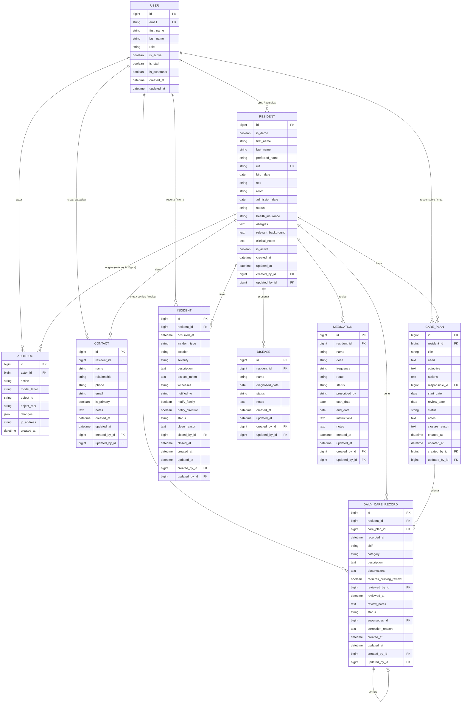

# Modelo de datos — Incrementos 1, 2 y 3

## Principios

- **Minimizar datos:** solo lo necesario para identificar, contactar y cuidar con seguridad.
- **Enfermedades y medicamentos editables por Enfermería:** diagnósticos y remedios son gestionados por Enfermería y pueden ser editados posteriormente tras guardarse (cambio de dosis, estado activo/suspendido, indicaciones) para mantener actualizada la prescripción.
- **Conservar la trazabilidad clínica:** las fichas se archivan y los registros de cuidado se corrigen con una nueva versión; las enfermedades y medicamentos pueden actualizarse o eliminarse por Enfermería, dejando cada cambio auditado.
- **Planes acordados, no generados:** el plan de cuidados lo escribe Enfermería; el sistema no genera objetivos, acciones ni recomendaciones clínicas.
- **Separar lo administrativo de lo clínico:** son formularios y permisos distintos.
- **No usar datos reales** durante el desarrollo, las pruebas ni las demostraciones.

## Diagrama de entidades

> `AUDITLOG` no tiene una clave foránea al registro afectado porque debe sobrevivir aunque el registro cambie de estado. Guarda `model_label` + `object_id` como referencia lógica.

## Entidades

### `accounts.User` — cuenta individual

| Campo | Tipo | Obligatorio | Reglas |
|---|---|:---:|---|
| `email` | correo | Sí | Único, normalizado en minúsculas. Es el identificador de acceso. |
| `first_name` | texto (150) | Sí | Nombre de la persona. |
| `last_name` | texto (150) | Sí | Apellidos. |
| `role` | selección | Sí | `DIRECCION`, `MEDICO`, `ENFERMERA_JEFE`, `ENFERMERIA`, `TECNICO`, `CUIDADOR`, `ADMINISTRACION`. |
| `is_active` | booleano | Sí | Una cuenta desactivada no puede iniciar sesión. No se elimina. |
| `is_staff` | booleano | Sí | Solo para superusuarios técnicos; no se activa por rol. |
| `is_superuser` | booleano | Sí | Acceso técnico excepcional. |
| `password` | hash | Sí | Almacenado por Django; nunca se muestra ni se audita. |
| `last_login` | fecha/hora | No | Gestionado por Django. |
| `created_at`, `updated_at` | fecha/hora | Sí | Zona horaria `America/Santiago`. |

**Regla:** no se puede desactivar la propia cuenta ni dejar cero cuentas activas con rol Administración (o superusuario activo).

### `residents.Resident` — ficha del residente

| Campo | Tipo | Obligatorio | Reglas |
|---|---|:---:|---|
| `is_demo` | booleano | Sí | `True` solo en datos ficticios. Se muestra una marca DEMO. |
| `first_name` | texto (100) | Sí | |
| `last_name` | texto (150) | Sí | |
| `preferred_name` | texto (80) | No | Nombre usado en el trato diario. |
| `rut` | texto (12) | Sí | Único; se normaliza a `12345678-9` y se valida el dígito verificador. |
| `birth_date` | fecha | Sí | No puede ser futura. |
| `sex` | selección | No | `F`, `M`, `OTRO`, `NO_INFORMA`. Dato opcional. |
| `room` | texto (20) | No | Habitación o sector. |
| `admission_date` | fecha | Sí | No puede ser anterior al nacimiento ni futura. |
| `status` | selección | Sí | `ACTIVO`, `HOSPITALIZADO`, `EGRESADO`, `FALLECIDO`. |
| `health_insurance` | selección | No | `FONASA`, `ISAPRE`, `PARTICULAR`, `OTRA`, `NO_INFORMA`. |
| `allergies` | texto | No | Alergias conocidas; vacío significa "no registradas", no "sin alergias". |
| `relevant_background` | texto | No | Antecedentes relevantes para el cuidado. Evitar diagnósticos innecesarios. |
| `clinical_notes` | texto | No | Observaciones acotadas de Enfermería. |
| `is_active` | booleano | Sí | `False` = ficha archivada. No se borra. |
| `created_at`, `updated_at` | fecha/hora | Sí | |
| `created_by`, `updated_by` | FK usuario | No | Se asignan automáticamente desde la sesión. `SET_NULL` si la cuenta se elimina. |

**Reglas**

1. El RUT se guarda normalizado y es único. La validación de dígito verificador se hace en el formulario y en el modelo.
2. La ficha archivada no se edita; primero se reactiva.
3. No existe borrado definitivo desde la aplicación.
4. El estado `FALLECIDO` no elimina la ficha ni los contactos.
5. Los campos clínicos solo los modifica Enfermería.
6. Los datos DEMO se excluyen de cualquier uso real y deben poder purgarse antes del piloto.

### `residents.Contact` — contacto del residente

| Campo | Tipo | Obligatorio | Reglas |
|---|---|:---:|---|
| `resident` | FK | Sí | `PROTECT`/`CASCADE` solo dentro de la ficha; la ficha no se borra. |
| `name` | texto (150) | Sí | Nombre completo del contacto. |
| `relationship` | texto (80) | Sí | Parentesco o vínculo. |
| `phone` | texto (30) | Sí | Formato libre acotado; se muestra tal como se registra. |
| `email` | correo | No | |
| `is_primary` | booleano | Sí | Máximo uno por residente. Al marcarlo, se desmarca el anterior. |
| `notes` | texto | No | Solo información de contacto; no datos clínicos. |
| `created_at`, `updated_at` | fecha/hora | Sí | |
| `created_by`, `updated_by` | FK usuario | No | Automáticos. |

**Reglas**

1. Al guardar un contacto como principal, los demás contactos del residente se desmarcan en la misma transacción.
2. Eliminar un contacto pide confirmación y deja un registro de auditoría con el snapshot anterior.
3. Si se elimina el contacto principal, no se promueve otro automáticamente; la ficha muestra una advertencia.
4. Los contactos de una ficha archivada son de solo lectura hasta reactivarla.

### `residents.Disease` — enfermedad o condición

| Campo | Tipo | Obligatorio | Reglas |
|---|---|:---:|---|
| `resident` | FK | Sí | Residente al que pertenece la condición. |
| `name` | texto (150) | Sí | Nombre de la enfermedad o condición. |
| `diagnosed_date` | fecha | No | Fecha de diagnóstico, si se conoce. |
| `status` | selección | Sí | `ACTIVA`, `CONTROLADA`, `EN_TRATAMIENTO` o `RESUELTA`; por defecto `ACTIVA`. |
| `notes` | texto | No | Observaciones o indicaciones clínicas. |
| `created_at`, `updated_at` | fecha/hora | Sí | Tiempos de auditoría del modelo. |
| `created_by`, `updated_by` | FK usuario | No | Actor que creó o modificó el registro. |

**Reglas**

1. Solo Médico/a, Enfermera/o Jefe y Enfermería crean, editan y eliminan enfermedades/condiciones desde la aplicación; los demás roles autorizados pueden consultarlas.
2. Se permite editar después de guardar para mantener actualizado el estado y las observaciones. Toda creación, edición o eliminación queda auditada.
3. Una ficha archivada bloquea estas operaciones.
4. El sistema registra información entregada por el equipo; no diagnostica ni recomienda tratamientos.

### `residents.Medication` — medicamento

| Campo | Tipo | Obligatorio | Reglas |
|---|---|:---:|---|
| `resident` | FK | Sí | Residente al que pertenece el tratamiento. |
| `name` | texto (150) | Sí | Nombre del medicamento. |
| `dose` | texto (100) | Sí | Dosis según la indicación profesional. |
| `frequency` | texto (120) | Sí | Frecuencia u horario indicado. |
| `route` | selección | Sí | Vía: oral, sublingual, subcutánea, intramuscular, tópica, oftálmica, ótica, inhalatoria, rectal u otra. |
| `status` | selección | Sí | `ACTIVO`, `SOS`, `SUSPENDIDO` o `FINALIZADO`; por defecto `ACTIVO`. |
| `prescribed_by` | texto (150) | No | Profesional que indica. |
| `start_date`, `end_date` | fecha | No | Fechas del tratamiento; término no puede preceder al inicio. |
| `instructions` | texto | No | Indicaciones especiales de administración. |
| `notes` | texto | No | Observaciones. |
| `created_at`, `updated_at` | fecha/hora | Sí | Tiempos de auditoría del modelo. |
| `created_by`, `updated_by` | FK usuario | No | Actor que creó o modificó el registro. |

**Reglas**

1. Solo Médico/a, Enfermera/o Jefe y Enfermería crean, editan y eliminan medicamentos desde la aplicación; los demás roles autorizados pueden consultarlos.
2. Se permite editar después de guardar para actualizar dosis, horario, estado, fechas o instrucciones. Toda creación, edición o eliminación queda auditada.
3. Una ficha archivada bloquea estas operaciones.
4. El registro no prescribe ni valida clínicamente un tratamiento; Enfermería debe mantener los datos conforme a la indicación profesional.

### `care.CarePlan` — plan de cuidados

| Campo | Tipo | Obligatorio | Reglas |
|---|---|:---:|---|
| `resident` | FK | Sí | Residente al que pertenece el plan. No se mueve a otro residente. |
| `title` | texto (150) | Sí | Necesidad o foco, sin diagnósticos médicos. |
| `need` | texto | No | Descripción de lo observado y por qué requiere un plan. |
| `objective` | texto | Sí | Resultado esperado y verificable. |
| `actions` | texto | Sí | Actividades concretas acordadas con el equipo. |
| `responsible` | FK usuario | No | Cuenta activa de Enfermería, Técnico/a o Cuidador/a. `SET_NULL` si se desactiva. |
| `start_date` | fecha | Sí | Por defecto hoy; no puede ser futura. |
| `review_date` | fecha | No | No puede ser anterior a `start_date`. |
| `status` | selección | Sí | `ACTIVO` o `CERRADO`. No se elimina. |
| `notes` | texto | No | Observaciones del plan. |
| `closure_reason` | texto | No | Obligatorio al cerrar (mínimo 10 caracteres); se limpia al reactivar. |
| `created_at`, `updated_at` | fecha/hora | Sí | |
| `created_by`, `updated_by` | FK usuario | No | Automáticos. |

**Reglas**

1. Solo Enfermería crea, edita, cierra o reactiva planes.
2. Un plan cerrado conserva sus registros asociados y se puede reactivar; ambas acciones quedan auditadas.
3. Una ficha archivada bloquea la creación, edición, cierre y reactivación del plan.
4. No existe borrado de planes desde la aplicación.
5. El plan es un acuerdo del equipo: el sistema no genera objetivos, acciones ni recomendaciones.

### `care.DailyCareRecord` — registro diario de cuidado

| Campo | Tipo | Obligatorio | Reglas |
|---|---|:---:|---|
| `resident` | FK | Sí | Residente activo al momento de registrar. |
| `care_plan` | FK | No | Plan activo del mismo residente; `SET_NULL` si el plan se elimina (no ocurre desde la app). |
| `recorded_at` | fecha/hora | Sí | Hora real del cuidado; no futura (margen de 5 minutos) ni anterior al ingreso. |
| `shift` | selección | Sí | `MANANA` (07–15), `TARDE` (15–23), `NOCHE` (23–07); se sugiere según la hora local. |
| `category` | selección | Sí | Alimentación, hidratación, eliminación, movilidad, sueño, higiene, actividad u otro. |
| `description` | texto | Sí | Hechos concretos; mínimo 10 caracteres. |
| `observations` | texto | No | Hasta 1000 caracteres; información para el próximo turno o Enfermería. |
| `requires_nursing_review` | booleano | Sí | Marca el registro para revisión. |
| `reviewed_by` | FK usuario | No | Se asigna al revisar; no editable desde formularios. |
| `reviewed_at` | fecha/hora | No | Se asigna al revisar; no editable desde formularios. |
| `review_notes` | texto | No | Observaciones de la revisión; hasta 1000 caracteres. |
| `status` | selección | Sí | `VIGENTE` o `CORREGIDO`. |
| `supersedes` | OneToOne al mismo modelo | No | Versión anterior que esta corrige; `PROTECT` y relación inversa `correction`. |
| `correction_reason` | texto | No | Obligatorio al corregir; 10 a 500 caracteres. |
| `created_at`, `updated_at` | fecha/hora | Sí | |
| `created_by`, `updated_by` | FK usuario | No | Automáticos. |

**Reglas**

1. Los registros no se editan ni se eliminan desde la aplicación.
2. Una corrección crea una versión nueva, enlaza el original con `supersedes` y marca el original como `CORREGIDO`. La relación OneToOne impide corregir dos veces el mismo registro.
3. Solo el autor del registro o Enfermería pueden corregirlo; Enfermería puede corregir cualquier registro vigente.
4. La corrección exige un motivo y queda auditada como `CORRECTION`; el original sigue consultable.
5. La revisión solo la realiza Enfermería y solo sobre registros vigentes marcados con `requires_nursing_review=True` y aún no revisados.
6. La revisión guarda `reviewed_by`, `reviewed_at` y `review_notes`, y queda auditada como `REVIEW`.
7. Una ficha archivada bloquea registro, corrección y revisión hasta reactivarla.
8. El registro no diagnostica ni indica tratamientos; solo describe el cuidado realizado.

### `audit.AuditLog` — historial de cambios

| Campo | Tipo | Obligatorio | Reglas |
|---|---|:---:|---|
| `actor` | FK usuario | No | `SET_NULL`; queda el correo en `actor_repr` si la cuenta se elimina. |
| `action` | selección | Sí | `CREATE`, `UPDATE`, `ARCHIVE`, `RESTORE`, `DELETE`, `PASSWORD`, `PASSWORD_RESET`, `DEACTIVATE`, `REACTIVATE`, `CORRECTION`, `REVIEW`. |
| `model_label` | texto (100) | Sí | Por ejemplo `residents.Resident`. |
| `object_id` | texto (64) | Sí | Identificador del registro afectado. |
| `object_repr` | texto (200) | Sí | Representación legible al momento del cambio. |
| `changes` | JSON | Sí | Campos cambiados con `label`, `before` y `after`. |
| `ip_address` | IP | No | Origen de la petición, si está disponible. |
| `created_at` | fecha/hora | Sí | Fecha del cambio. |

**Reglas**

1. La auditoría es **append-only**: no se edita ni se elimina desde la aplicación.
2. Nunca guarda contraseñas, hashes, tokens ni contenido de sesión.
3. Los cambios de contraseña se registran como acción sin valores.
4. Solo Dirección y Administración pueden consultarla.
5. La auditoría contiene datos personales y clínicos; se protege como parte de la ficha y se excluye de logs técnicos.
6. La retención de la auditoría debe definirse con asesoría legal; no se purga automáticamente en el MVP.
7. Las correcciones y revisiones de cuidados se registran sin borrar el evento anterior; el historial permite reconstruir qué cambió y quién lo hizo.

### `incidents.Incident` — reporte de incidente (incremento 3)

| Campo | Tipo | Obligatorio | Reglas |
|---|---|:---:|---|
| `resident` | FK | Sí | Solo se puede seleccionar una ficha activa al reportar; la relación protege la conservación del historial. |
| `occurred_at` | fecha/hora | Sí | No futura (margen de cinco minutos) ni anterior al ingreso. |
| `incident_type` | selección | Sí | Caída, lesión sin caída, error de medicación, desorientación, salida no autorizada, agresión u otro. |
| `location` | texto (150) | No | Lugar del incidente. |
| `severity` | selección | Sí | Leve, moderado o grave percibido; no es una clasificación clínica. |
| `description` | texto | Sí | Hechos objetivos; mínimo 10 caracteres. |
| `actions_taken` | texto | Sí | Acciones inmediatas; mínimo 10 caracteres. |
| `witnesses` | texto (500) | No | Personas presentes; evitar datos innecesarios. |
| `notified_to` | texto (150) | No | A quién se avisó. |
| `notify_family`, `notify_direction` | booleano | Sí | Indicadores de notificación/seguimiento, no envían comunicaciones. |
| `status` | selección | Sí | `ABIERTO` o `CERRADO`. |
| `close_reason` | texto | No | Seguimiento requerido al cerrar; mínimo 10 caracteres. |
| `closed_by`, `closed_at` | FK/fecha-hora | No | Se asignan al cerrar por Enfermería o Dirección. |
| `created_by`, `updated_by`, fechas | FK/fecha-hora | Sí | Autoría y auditoría automática. |

**Reglas:** solo Enfermería, Técnico/a y Cuidador/a reportan; Enfermería, Técnico/a, Cuidador/a y Dirección consultan; solo Enfermería y Dirección cierran y acceden a informes agregados. Administración no puede consultar incidentes ni sus eventos detallados de auditoría. Los reportes no se editan ni eliminan desde la aplicación. El formulario no sustituye avisos inmediatos ni protocolos institucionales. Campos y reglas quedan pendientes de validación con el ELEAM.

## Clasificación de datos

| Categoría | Ejemplos | Protección mínima |
|---|---|---|
| Identificación | Nombre, RUT, fecha de nacimiento, habitación | Acceso autenticado; auditoría de cambios; no logs. |
| Contacto | Teléfono, correo, parentesco | Acceso autenticado; no exportación masiva en el MVP. |
| Salud | Alergias, antecedentes, enfermedades, medicamentos y observaciones | Acceso autenticado; edición solo Enfermería; no logs técnicos. Los cambios se guardan en la auditoría protegida. |
| Cuidados | Plan, registros por turno, correcciones y revisiones | Acceso autenticado; registro por roles autorizados; no logs. |
| Auditoría | Actor, cambios, IP | Solo Dirección y Administración; retención definida. |
| Credenciales | Hash de contraseña | Nunca se muestra, exporta ni audita. |

## Reglas transversales

- **Fechas:** se guardan en UTC y se muestran en `America/Santiago`.
- **RUT:** se aceptan con o sin puntos y con guion; se normaliza antes de guardar.
- **Búsqueda:** por nombre, apellido, RUT o habitación; no se expone a usuarios anónimos.
- **Paginación:** la lista de residentes se pagina de a 12.
- **Integridad:** las operaciones que afectan residente, contacto, cuidado y auditoría ocurren en una transacción por petición (`ATOMIC_REQUESTS`).
- **Inmutabilidad:** un registro de cuidado no se actualiza ni se borra; la corrección crea otra fila y conserva la anterior.
- **Revisión:** el estado pendiente se deriva de `requires_nursing_review=True`, `reviewed_at` vacío y `status=VIGENTE`.
- **Planes:** un plan cerrado no se elimina; se conserva para el historial y puede reactivarse con auditoría.
 - **Exportación:** la nómina de residentes se puede descargar como CSV para Dirección, Enfermera/o Jefe y Administración; la descarga audita filtros y total. El archivo contiene datos personales y requiere controles de acceso y manejo definidos por el ELEAM. No se exportan cuidados ni incidentes. Las exportaciones adicionales no están implementadas.
- **Respaldo:** la base de producción (PostgreSQL) se respalda cifrada; las restauraciones se prueban.

## Decisiones pendientes

- [ ] ¿Se requiere un identificador interno adicional al RUT (por ejemplo, número de ficha)?
- [ ] ¿Se guardará foto del residente? (No en el MVP; implicaría almacenamiento y consentimiento).
- [ ] ¿Qué categorías de cuidado y campos exactos usará el equipo en el plan y en los registros?
- [ ] ¿Qué registros requieren revisión obligatoria de Enfermería y en qué plazo?
- [ ] ¿Se permite corregir registros de días anteriores o solo del turno actual?
- [ ] ¿Quién puede corregir registros de otra persona además de Enfermería?
- [ ] ¿Cuánto tiempo se conservan ficha, contactos, cuidados y auditoría después del egreso o fallecimiento?
- [ ] ¿Se requiere registrar tutores o representantes legales con vigencia?
- [ ] ¿Se mantienen los campos y roles de la exportación CSV actual de residentes y qué reglas aplican a los archivos descargados?
- [ ] ¿Se necesitan otras exportaciones y quién autoriza cada una?
- [ ] ¿Se necesita historial de habitaciones o traslados?
