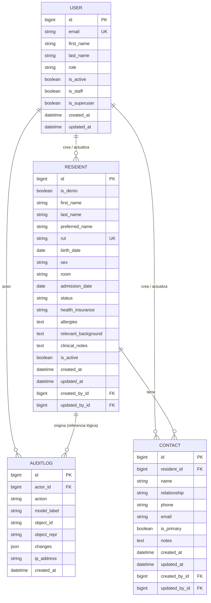

# Modelo de datos — Incremento 1

## Principios

- **Minimizar datos:** solo lo necesario para identificar, contactar y cuidar con seguridad.
- **No almacenar diagnósticos estructurados en el MVP:** "antecedentes relevantes" y "alergias" son texto libre acotado, revisado por Enfermería.
- **No eliminar información clínica:** las fichas se archivan; las correcciones quedan en auditoría.
- **Separar lo administrativo de lo clínico:** son formularios y permisos distintos.
- **No usar datos reales** durante el desarrollo, las pruebas ni las demostraciones.

## Diagrama de entidades

> `AUDITLOG` no tiene una clave foránea al registro afectado porque debe sobrevivir aunque el registro cambie de estado. Guarda `model_label` + `object_id` como referencia lógica.

## Entidades

### `accounts.User` — cuenta individual

| Campo | Tipo | Obligatorio | Reglas |
|---|---|:---:|---|
| `email` | correo | Sí | Único, normalizado en minúsculas. Es el identificador de acceso. |
| `first_name` | texto (150) | Sí | Nombre de la persona. |
| `last_name` | texto (150) | Sí | Apellidos. |
| `role` | selección | Sí | `DIRECCION`, `ENFERMERIA`, `TECNICO`, `CUIDADOR`, `ADMINISTRACION`. |
| `is_active` | booleano | Sí | Una cuenta desactivada no puede iniciar sesión. No se elimina. |
| `is_staff` | booleano | Sí | Solo para superusuarios técnicos; no se activa por rol. |
| `is_superuser` | booleano | Sí | Acceso técnico excepcional. |
| `password` | hash | Sí | Almacenado por Django; nunca se muestra ni se audita. |
| `last_login` | fecha/hora | No | Gestionado por Django. |
| `created_at`, `updated_at` | fecha/hora | Sí | Zona horaria `America/Santiago`. |

**Regla:** no se puede desactivar la propia cuenta ni dejar cero cuentas activas con rol Administración (o superusuario activo).

### `residents.Resident` — ficha del residente

| Campo | Tipo | Obligatorio | Reglas |
|---|---|:---:|---|
| `is_demo` | booleano | Sí | `True` solo en datos ficticios. Se muestra una marca DEMO. |
| `first_name` | texto (100) | Sí | |
| `last_name` | texto (150) | Sí | |
| `preferred_name` | texto (80) | No | Nombre usado en el trato diario. |
| `rut` | texto (12) | Sí | Único; se normaliza a `12345678-9` y se valida el dígito verificador. |
| `birth_date` | fecha | Sí | No puede ser futura. |
| `sex` | selección | No | `F`, `M`, `OTRO`, `NO_INFORMA`. Dato opcional. |
| `room` | texto (20) | No | Habitación o sector. |
| `admission_date` | fecha | Sí | No puede ser anterior al nacimiento ni futura. |
| `status` | selección | Sí | `ACTIVO`, `HOSPITALIZADO`, `EGRESADO`, `FALLECIDO`. |
| `health_insurance` | selección | No | `FONASA`, `ISAPRE`, `PARTICULAR`, `OTRA`, `NO_INFORMA`. |
| `allergies` | texto | No | Alergias conocidas; vacío significa "no registradas", no "sin alergias". |
| `relevant_background` | texto | No | Antecedentes relevantes para el cuidado. Evitar diagnósticos innecesarios. |
| `clinical_notes` | texto | No | Observaciones acotadas de Enfermería. |
| `is_active` | booleano | Sí | `False` = ficha archivada. No se borra. |
| `created_at`, `updated_at` | fecha/hora | Sí | |
| `created_by`, `updated_by` | FK usuario | No | Se asignan automáticamente desde la sesión. `SET_NULL` si la cuenta se elimina. |

**Reglas**

1. El RUT se guarda normalizado y es único. La validación de dígito verificador se hace en el formulario y en el modelo.
2. La ficha archivada no se edita; primero se reactiva.
3. No existe borrado definitivo desde la aplicación.
4. El estado `FALLECIDO` no elimina la ficha ni los contactos.
5. Los campos clínicos solo los modifica Enfermería.
6. Los datos DEMO se excluyen de cualquier uso real y deben poder purgarse antes del piloto.

### `residents.Contact` — contacto del residente

| Campo | Tipo | Obligatorio | Reglas |
|---|---|:---:|---|
| `resident` | FK | Sí | `PROTECT`/`CASCADE` solo dentro de la ficha; la ficha no se borra. |
| `name` | texto (150) | Sí | Nombre completo del contacto. |
| `relationship` | texto (80) | Sí | Parentesco o vínculo. |
| `phone` | texto (30) | Sí | Formato libre acotado; se muestra tal como se registra. |
| `email` | correo | No | |
| `is_primary` | booleano | Sí | Máximo uno por residente. Al marcarlo, se desmarca el anterior. |
| `notes` | texto | No | Solo información de contacto; no datos clínicos. |
| `created_at`, `updated_at` | fecha/hora | Sí | |
| `created_by`, `updated_by` | FK usuario | No | Automáticos. |

**Reglas**

1. Al guardar un contacto como principal, los demás contactos del residente se desmarcan en la misma transacción.
2. Eliminar un contacto pide confirmación y deja un registro de auditoría con el snapshot anterior.
3. Si se elimina el contacto principal, no se promueve otro automáticamente; la ficha muestra una advertencia.
4. Los contactos de una ficha archivada son de solo lectura hasta reactivarla.

### `audit.AuditLog` — historial de cambios

| Campo | Tipo | Obligatorio | Reglas |
|---|---|:---:|---|
| `actor` | FK usuario | No | `SET_NULL`; queda el correo en `actor_repr` si la cuenta se elimina. |
| `action` | selección | Sí | `CREATE`, `UPDATE`, `ARCHIVE`, `RESTORE`, `DELETE`, `PASSWORD`, `PASSWORD_RESET`, `DEACTIVATE`, `REACTIVATE`. |
| `model_label` | texto (100) | Sí | Por ejemplo `residents.Resident`. |
| `object_id` | texto (64) | Sí | Identificador del registro afectado. |
| `object_repr` | texto (200) | Sí | Representación legible al momento del cambio. |
| `changes` | JSON | Sí | Campos cambiados con `label`, `before` y `after`. |
| `ip_address` | IP | No | Origen de la petición, si está disponible. |
| `created_at` | fecha/hora | Sí | Fecha del cambio. |

**Reglas**

1. La auditoría es **append-only**: no se edita ni se elimina desde la aplicación.
2. Nunca guarda contraseñas, hashes, tokens ni contenido de sesión.
3. Los cambios de contraseña se registran como acción sin valores.
4. Solo Dirección y Administración pueden consultarla.
5. La auditoría contiene datos personales y clínicos; se protege como parte de la ficha y se excluye de logs técnicos.
6. La retención de la auditoría debe definirse con asesoría legal; no se purga automáticamente en el MVP.

## Clasificación de datos

| Categoría | Ejemplos | Protección mínima |
|---|---|---|
| Identificación | Nombre, RUT, fecha de nacimiento, habitación | Acceso autenticado; auditoría de cambios; no logs. |
| Contacto | Teléfono, correo, parentesco | Acceso autenticado; no exportación masiva en el MVP. |
| Salud | Alergias, antecedentes, observaciones | Acceso autenticado; edición solo Enfermería; no logs. |
| Auditoría | Actor, cambios, IP | Solo Dirección y Administración; retención definida. |
| Credenciales | Hash de contraseña | Nunca se muestra, exporta ni audita. |

## Reglas transversales

- **Fechas:** se guardan en UTC y se muestran en `America/Santiago`.
- **RUT:** se aceptan con o sin puntos y con guion; se normaliza antes de guardar.
- **Búsqueda:** por nombre, apellido, RUT o habitación; no se expone a usuarios anónimos.
- **Paginación:** la lista de residentes se pagina de a 12.
- **Integridad:** las operaciones que afectan residente, contacto y auditoría ocurren en una transacción por petición (`ATOMIC_REQUESTS`).
- **Exportación:** no incluida en el incremento 1. Si se agrega, debe tener permisos, registro de auditoría y límites de columnas.
- **Respaldo:** la base de producción (PostgreSQL) se respalda cifrada; las restauraciones se prueban.

## Decisiones pendientes

- [ ] ¿Se requiere un identificador interno adicional al RUT (por ejemplo, número de ficha)?
- [ ] ¿Se guardará foto del residente? (No en el MVP; implicaría almacenamiento y consentimiento).
- [ ] ¿Qué campos clínicos exactos se usarán en el plan de cuidados?
- [ ] ¿Cuánto tiempo se conservan ficha, contactos y auditoría después del egreso o fallecimiento?
- [ ] ¿Se requiere registrar tutores o representantes legales con vigencia?
- [ ] ¿Qué datos se pueden exportar y quién autoriza cada exportación?
- [ ] ¿Se necesita historial de habitaciones o traslados?
